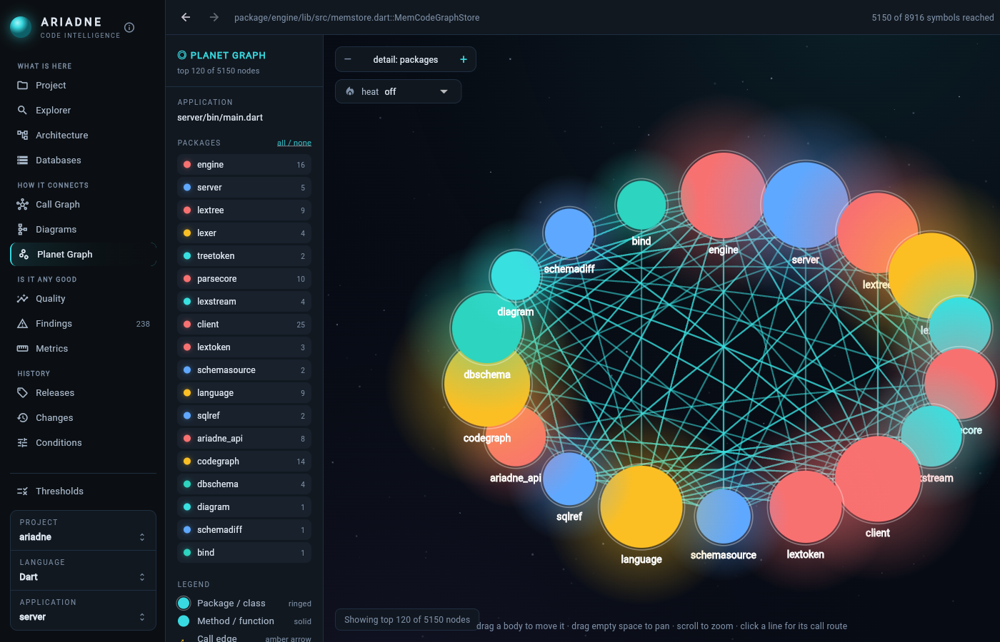
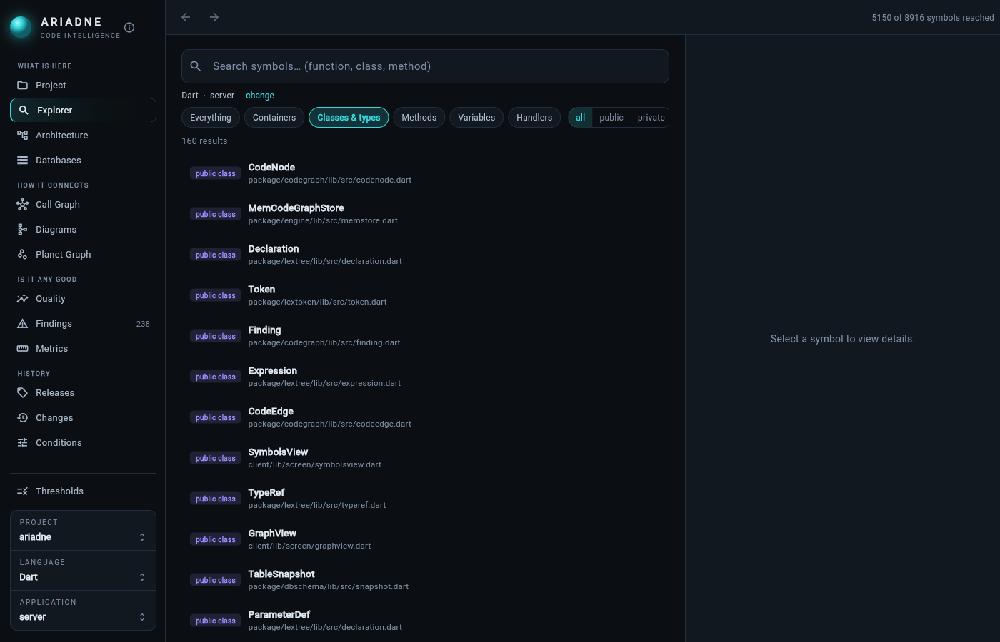
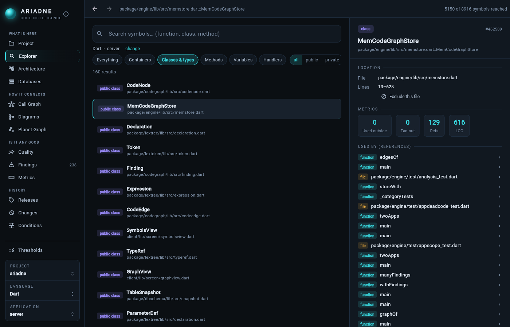
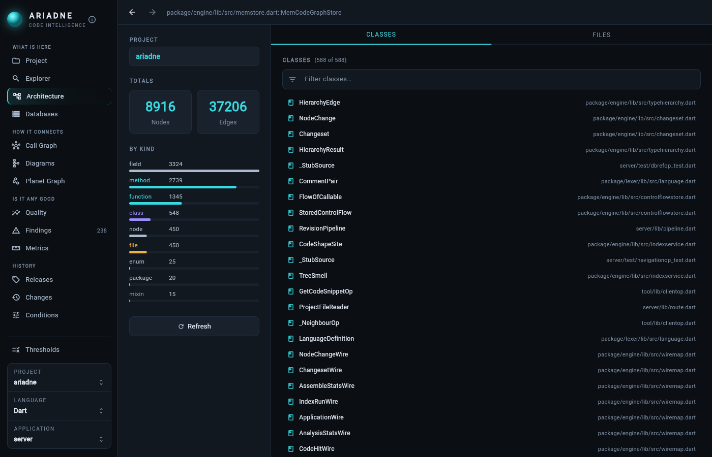
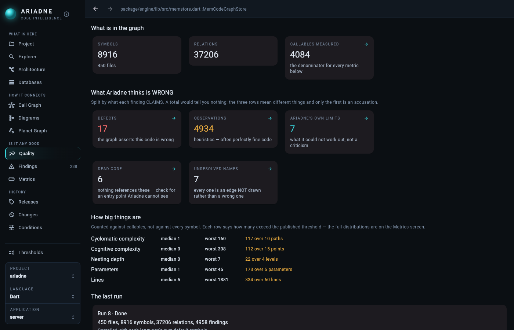
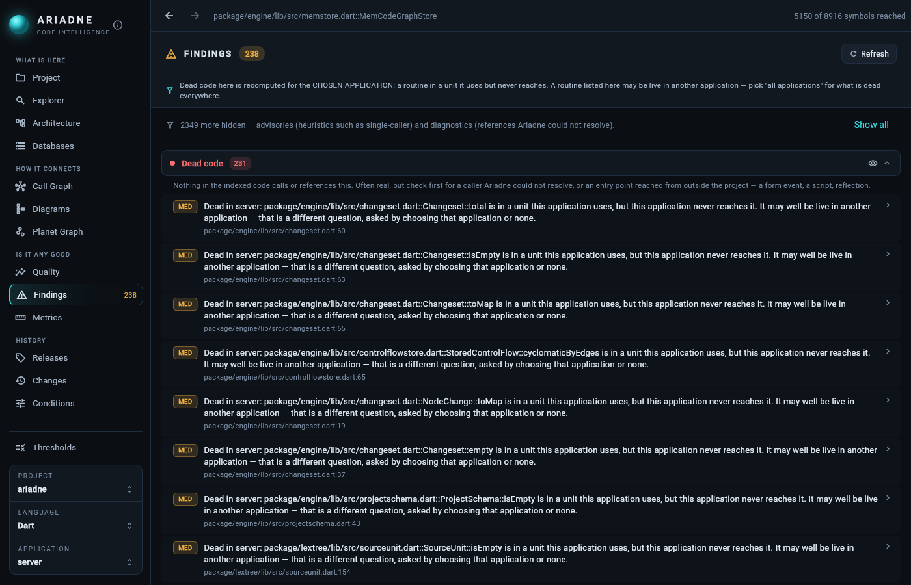

# Ariadne

**A code graph for Claude.** Ariadne indexes a codebase into a graph of its symbols and how they
connect — who calls what, where a type is used, what is unreachable, which code reads or writes
which database table — and answers those questions over a command line, an MCP server and a web
UI. It answers *"who calls this?"* from the parse tree, not from a text match.

Languages: **Dart, Delphi / Object Pascal (including `.dfm` forms), Java, C# and Rust.**



This repository holds **compiled releases only** — no source. Each [release](../../releases) has
the server images and the client executables attached; the scripts and documentation to run them
are here.

---

## In use

Ariadne is not a demo. It has been in daily use since mid-2026, indexing a dozen real projects on
a home-lab server — Dart services and Flutter apps, and a 100,000-symbol Delphi estate where
*"who calls this?"* is not a question grep can answer. Claude Code sessions use it to find the
code behind a screen before changing it, to check what a change will reach, and to find dead code.

Measured from a month of Claude Code session logs (10 September – 10 October 2026):

| | |
|---|---|
| Ariadne calls | **334**, from 61 sessions across 12 projects |
| Questions answered | **82%** — and most failures never reached Ariadne (a shell or permission prompt in the way) |
| Answers trusted | **85%** of lookups were acted on without a grep to double-check |
| Largest graph | **107,624** symbols, **327,260** relations |

It is built with its own medicine: 740 commits and 211 test files, and the defects its users
reported — a live call path read as dead code, a type made ambiguous by two files of the same
name — are fixed in the release that follows.

---

## What it answers

**Where is it, and what is it?**

```
$ ariadne_cli searchgraph --project ariadne --query whereUsed
19 symbols:
  package/engine/lib/src/query.dart::whereUsed  [7]  package/engine/lib/src/query.dart:398
  tool/lib/clientop.dart::WhereUsedOp           [4]  tool/lib/clientop.dart:367
  ...
```

**Who calls it?**

```
$ ariadne_cli callers --project ariadne --qn "package/engine/lib/src/analysis.dart::reachableWith"
2 Callers of package/engine/lib/src/analysis.dart::reachableWith:
  package/engine/lib/src/analysis.dart::reachableIds              package/engine/lib/src/analysis.dart:114
  package/engine/lib/src/appdeadcode.dart::applicationFootprint   package/engine/lib/src/appdeadcode.dart:104
```

**What uses it at all** — calls, reads, and the code that constructs it:

```
$ ariadne_cli whereused --project ariadne --qn "package/engine/lib/src/memstore.dart::MemCodeGraphStore"
129 Uses of package/engine/lib/src/memstore.dart::MemCodeGraphStore:
  package/engine/test/analysis_test.dart::storeWith   package/engine/test/analysis_test.dart:260
  ...
```

Also: `callees`, `getcodesnippet`, `findings` (dead code, complexity, smells — each saying what it
claims and how sure it is), `getarchitecture`, `tracepath`, `diagram` (flowchart, sequence, class),
and for databases `schema`, `tableused` and `schemadiff` — what the code and the database disagree
about.

**From Claude**, the same questions are MCP tools:

```
claude mcp add ariadne -- D:\tool\ariadne_mcp.exe --url=http://<server>:8193
```

---

## The web UI

| | |
|---|---|
|  |  |
| **Explorer** — every symbol, filtered by kind and visibility | **A symbol** — where it is, its metrics, and what uses it |
|  |  |
| **Architecture** — what the project holds, by kind | **Quality** — findings split by what they claim, and the complexity distribution |



**Findings** — dead code worked out per application: a routine can be dead in one program and
live in another that shares the unit, and the finding says which question it answered.

---

## Quick start

1. Download the latest [release](../../releases) assets.
2. On the server box (Linux with podman or docker), put the two image tarballs in `server/`:

   ```bash
   cd server
   cp ariadne.env.example ariadne.env     # edit the data paths
   ./run-ariadne.sh                       # loads, starts, and checks it answered
   ```

   With docker instead of podman, use `compose.yaml` — see [DEPLOYMENT.md](DEPLOYMENT.md).

3. On each client machine, put the executables in `client/` and run:

   ```
   Windows:  install-client.cmd http://<server>:8193
   Linux:    ./install-client.sh http://<server>:8193
   ```

4. Index a repository and ask it something:

   ```bash
   ariadne_cli index C:/path/to/repo --project=myproject
   ariadne_cli searchgraph --project myproject --query Customer
   ```

[**DEPLOYMENT.md**](DEPLOYMENT.md) is the full guide: requirements, settings, the secret you must
back up, upgrading, offline installs and troubleshooting.

## Uploads

`index` uploads the source tree to your server, which stores it and builds the graph. It honours
each repository's `.gitignore`, never uploads `.ssh/` or `.claude/`, and skips build output and
binaries. Point it only at code you are happy to have stored on your Ariadne server.
